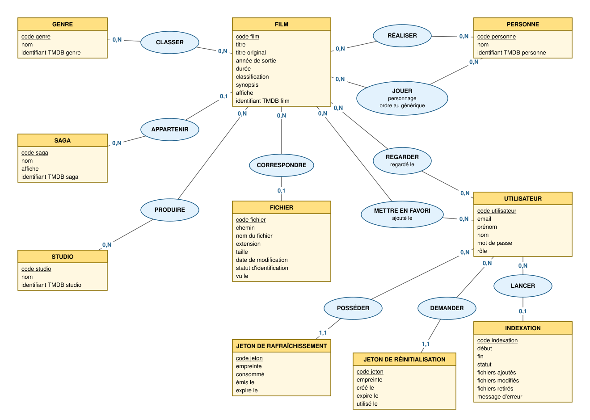

# shub-index

Moteur de recherche pour une vidéothèque personnelle stockée sur un NAS.
On retrouve un film en quelques secondes — « un film de 1992 réalisé par
Fincher », « un film avec Sigourney Weaver », « tous les Marvel », « la saga
Star Wars » — puis on le **lance dans VLC** depuis le réseau local.

Projet personnel réalisé pendant une formation **Concepteur Développeur
d'Applications** (O'Clock), pour mettre en pratique les cours : conception
Merise et UML, API REST en Express + TypeScript, PostgreSQL en **SQL brut**
(pattern DataMapper, sans ORM), client React, Docker, tests.

## Fonctionnalités

- **Indexation du NAS** : parcourt le partage (lecture seule), lit titre,
  année et réalisateur dans le nom de chaque fichier, retrouve le film sur
  [TMDB](https://www.themoviedb.org/) (en vérifiant le réalisateur) et
  l'enregistre avec ses genres, acteurs, saga, studios et classification.
  Les fichiers inchangés ne sont pas réinterrogés ; un fichier disparu est
  retiré, **sauf** si le partage semble non monté (garde-fou).
- **Recherche multicritère**, sans tenir compte des accents :
  - un champ unique **titre, saga ou studio** (`alien`, `star wars`, `marvel`) ;
  - réalisateur, acteur, année ou plage d'années, genres, classification maximale.
- **Fiches** film et personne (filmographie comme réalisateur et comme acteur).
- **Lecture dans VLC** : le bouton télécharge une playlist `.m3u` (`smb://…`) ;
  VLC lit directement sur le NAS. Réservé au réseau local.
- **Mon compte** : modifier son nom et son email, changer son mot de passe,
  supprimer son compte, **10 favoris**, historique des **10 derniers films**
  lancés dans VLC.
- **Administration** : lancer et suivre une indexation, associer à la main
  les fichiers non reconnus, corriger un film, gérer les comptes.

## Architecture

```text
NAS (lecture seule) ──▶ indexation ──▶ PostgreSQL ◀── API Express ◀── client React
                            │                                            │
                            └──▶ TMDB (métadonnées)        VLC ◀── .m3u ─┘ (réseau local)
```

| Couche | Technologies |
| --- | --- |
| API | Node.js 22, Express 5, TypeScript, `pg` (requêtes paramétrées), Zod, Argon2, JWT en cookies `httpOnly` |
| Base | PostgreSQL 16 (extension `unaccent`) |
| Client | React, React Router, Context API, Vite ; servi par Nginx |
| Déploiement | Docker Compose (3 conteneurs), derrière un reverse proxy (Caddy) |
| Tests | `node:test` (unitaires et intégration), axios, fichiers `.http` (httpyac) |

Conception complète — besoin, user stories, Merise (MCD → MPD), UML, API
REST, droits par rôle : [docs/conception](docs/conception/README.md).



## Installation avec Docker

Trois conteneurs : `shub-db` (PostgreSQL), `shub-api` (Express, build
multi-étapes) et `shub-client` (React compilé servi par Nginx, qui relaie
`/api`). L'API ne publie **aucun port** : elle n'est joignable que par le
proxy, condition pour que la détection du réseau local soit fiable.

```bash
cp .env.example .env    # puis remplir : mots de passe, TMDB_TOKEN, adresse du NAS…
docker compose up -d --build
# → http://localhost:8080
```

Un jeton TMDB (« API Read Access Token ») gratuit est nécessaire :
<https://www.themoviedb.org/settings/api>.

Premier compte admin : s'inscrire depuis le site, puis

```bash
docker compose exec shub-db sh -c 'psql -U "$POSTGRES_USER" -d "$POSTGRES_DB" \
  -c "UPDATE \"user\" SET role = '"'"'admin'"'"' WHERE email = '"'"'moi@exemple.fr'"'"';"'
```

Indexation en ligne de commande (tâche planifiée, cron) :
`docker compose exec -T shub-api npm run scan`.

> En local, le site n'écoute que sur `127.0.0.1` : en HTTP, un navigateur
> refuse le cookie de connexion `Secure` ailleurs que sur `localhost`.
> L'accès depuis d'autres appareils passe par un déploiement en HTTPS.

### Le partage réseau

`docker-compose.yml` déclare un volume NFS que Docker monte lui-même, en
lecture seule, à partir de `NAS_ADDRESS` et `NAS_SHARE_PATH` (`.env`).
`docker-compose.aldebaran.yml` est un exemple de surcharge pour la
production : aucun port publié, réseau du reverse proxy, partage lu via un
automount de l'hôte (utile si le NAS s'éteint la nuit).

### Dépannage réseau

| Symptôme | Cause probable | Solution |
| --- | --- | --- |
| Le site **expire** (`ERR_CONNECTION_TIMED_OUT`) sur un appareil de la maison, alors qu'il répond depuis un autre | l'appareil est sur le **Wi-Fi invité** de la box : ce réseau est isolé, il ne peut pas revenir vers l'IP publique de la maison | connecter l'appareil au Wi-Fi principal (et « oublier » le réseau invité) |
| Pas de bouton VLC ni de chemins de fichiers, alors qu'on est à la maison | l'API ne voit pas la requête comme locale : l'IP publique de la box n'est pas déclarée, ou un proxy n'est pas de confiance | renseigner `LAN_PUBLIC_HOSTNAME` (nom DNS de la box) et `TRUST_PROXY` (adresse du seul reverse proxy) |
| Pas de bouton VLC **via le VPN** (WireGuard en tunnel partiel) | le nom du site pointe vers l'IP publique, qui ne passe pas par le tunnel : la requête part par la 4G | ajouter la plage du VPN à `LAN_CIDRS`, et sur l'appareil une ligne `hosts` qui associe le nom du site à l'adresse locale du serveur |

Hors réseau local, c'est voulu : l'API ne renvoie **aucun chemin** du NAS
(`files: []`) et la fiche affiche seulement un message.

## Installation sans Docker (développement)

```bash
# API (port 4000)
cd src/api
npm install
cp .env.example .env    # DATABASE_URL, TMDB_TOKEN, SHARE_ROOT…
npm run db:init         # crée les tables (database/init.sql)
npm run db:seed         # comptes de test
npm run scan:dev        # première indexation
npm run dev

# Client (port 5173, /api relayé vers l'API par Vite)
cd src/client
npm install
npm run dev
```

### Mettre à jour une base existante

`database/init.sql` crée une base **neuve** (il efface tout). Pour une base
déjà remplie, jouer les migrations de `src/api/database/migration-*.sql`
(idempotentes), puis `npm run backfill` (simulation) et
`npm run backfill -- --apply` pour compléter sagas, studios et
classifications des films déjà importés.

## Tests

```bash
cd src/api
npm test            # 46 tests unitaires : parseur de noms, réseau local, playlist, TMDB
npm run test:spec   # 45 tests d'intégration (Docker requis)
```

- Les tests **d'intégration** (`src/**/*.spec.test.ts`) démarrent une base
  PostgreSQL jetable dans Docker, lancent l'API, et l'interrogent avec axios
  comme le ferait le navigateur. La base est vidée avant chaque test.
- Les fichiers `tests/*.http` (un par ressource) se lancent avec
  [httpyac](https://httpyac.github.io/) ou l'extension REST Client.
- Documentation interactive de l'API (Swagger) : `/api/docs` (connexion requise).

## Scripts

| Où | Script | Rôle |
| --- | --- | --- |
| `src/api` | `npm run dev` | API en développement (`tsx --watch`) |
| `src/api` | `npm run build` / `npm start` | compilation puis démarrage en production |
| `src/api` | `npm run scan` / `scan:dev` | indexation en ligne de commande |
| `src/api` | `npm run backfill` | complète les films déjà importés (simulation ; `-- --apply` pour écrire) |
| `src/api` | `npm test` / `npm run test:spec` | tests unitaires / d'intégration |
| `src/api` | `npm run db:init` / `db:seed` / `db:reset` | tables / comptes de test |
| `src/client` | `npm run dev` / `npm run build` | client en développement / compilation |

## Structure

```text
shub-index/
├── docker-compose.yml           # shub-db + shub-api + shub-client
├── docker-compose.aldebaran.yml # exemple de surcharge pour la production
├── docs/conception/             # besoin, Merise (MCD draw.io), UML, API REST
├── tests/                       # tests .http par ressource
└── src/
    ├── api/                     # Express + TypeScript + PostgreSQL (SQL brut)
    │   ├── database/            # init.sql (MPD) + migrations
    │   ├── tests/               # unitaires + configuration des tests d'intégration
    │   └── src/
    │       ├── controllers/     # validation Zod + orchestration (ni SQL ni HTML)
    │       ├── lib/             # tokens, erreurs, réseau local, playlist
    │       ├── middlewares/     # isConnected, checkRoles, isLocalNetwork, erreurs
    │       ├── models/          # DataMappers (requêtes paramétrées), transactions
    │       ├── routers/         # routes + annotations OpenAPI
    │       └── services/        # parseur de noms, client TMDB, import, indexation
    └── client/                  # React (Vite)
        └── src/
            ├── api/             # fetch + renouvellement automatique du jeton
            ├── context/         # AuthContext
            ├── hooks/           # useApi
            ├── components/      # mise en page, cartes, routes protégées…
            └── pages/           # recherche, fiches, mon compte, admin
```

## Sécurité

- SQL toujours paramétré ; colonnes de tri et champs modifiables en liste blanche.
- Cookies `httpOnly; Secure; SameSite=Strict` ; refresh token en rotation
  avec détection de réutilisation ; changer son mot de passe ferme toutes les sessions.
- Mots de passe Argon2 ; message **et durée** de réponse identiques pour un
  email inconnu ou un mauvais mot de passe ; **10 mots de passe faux** par IP
  et par 15 min au maximum (`429`), réglable avec `AUTH_RATE_LIMIT`.
- Le compte est relu en base à chaque requête : un compte supprimé ou un
  admin rétrogradé perd ses droits **immédiatement**, sans attendre
  l'expiration de son jeton (1 h). Emails normalisés en minuscules.
- Rôles `member` / `admin` ; les routes « mon compte » lisent l'utilisateur
  dans le jeton, jamais dans l'URL.
- Lecture VLC limitée au réseau local, sans faire confiance à un
  `X-Forwarded-For` forgé ; partage monté en lecture seule ; CSP stricte.
- Secrets (`JWT_SECRET`, `TMDB_TOKEN`) uniquement dans `.env`, jamais commités ;
  l'API refuse de démarrer sans `JWT_SECRET`. Conteneur de l'API sans root.

## Crédits

Données de films fournies par [TMDB](https://www.themoviedb.org/). Ce
produit utilise l'API TMDB mais n'est ni approuvé ni certifié par TMDB.
